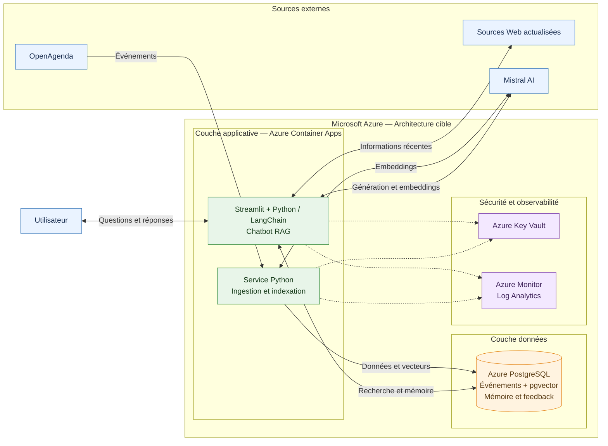

# Architecture technique cible — MVP Puls-Events

## 1. Contexte et objectifs

Le projet Puls-Events vise à faire évoluer un Proof of Concept (POC) de recherche sémantique vers un Minimum Viable Product (MVP) destiné à la découverte et à la recommandation d'événements culturels.

Le POC existant repose sur Python, LangChain, Mistral AI, FAISS et une interface Streamlit. Il a permis de démontrer la faisabilité d'un moteur de recherche sémantique utilisant une architecture RAG (*Retrieval-Augmented Generation*).

L'architecture cible doit permettre d'intégrer quatre fonctionnalités prioritaires :

- La mémoire conversationnelle pour conserver le contexte des échanges.
- La personnalisation géographique des recommandations.
- La recherche d'informations actualisées auprès de sources externes.
- Le monitoring technique et la collecte des retours de satisfaction.

Elle doit également répondre aux exigences de sécurité, de confidentialité, de maintenabilité, de maîtrise des coûts et de montée en charge.

## 2. Principes de conception

L'architecture proposée repose sur les principes suivants :

1. **Modularité :** séparer la collecte des événements, leur traitement, la recherche sémantique, la génération des réponses et l'interface utilisateur.
2. **Persistance :** utiliser une base PostgreSQL avec l'extension pgvector pour stocker les événements et leurs représentations vectorielles.
3. **Scalabilité :** privilégier des services applicatifs conteneurisés pouvant adapter leurs ressources à la charge.
4. **Sécurité :** protéger les données, les accès et les secrets techniques.
5. **Observabilité :** suivre les latences, les erreurs, les consommations API et la disponibilité.
6. **Maîtrise des coûts :** dimensionner progressivement les ressources et mesurer les dépenses réelles.

## 3. Choix du fournisseur cloud

L'étude comparative documentée dans `docs/comparaison_cloud.md` a évalué AWS, Microsoft Azure et Google Cloud selon six critères pondérés par la méthode AHP.

Microsoft Azure arrive en tête de l'évaluation avec un score de 83,49/100, devant AWS (81,85/100) et Google Cloud (77,84/100).

Azure est donc retenu **à titre provisoire** comme fournisseur privilégié pour l'architecture cible.

Ce choix reste soumis à la consolidation des estimations BUILD/OPEX, à la validation du dimensionnement et aux essais techniques.

## 4. Composants principaux de l'architecture cible

| Composant | Technologie envisagée | Rôle |
|---|---|---|
| Interface utilisateur | Streamlit | Interaction avec le chatbot et collecte des retours |
| Hébergement applicatif | Azure Container Apps | Exécution des composants applicatifs conteneurisés |
| Orchestration RAG | Python et LangChain | Traitement des questions, récupération du contexte et génération des réponses |
| Modèles d'IA | API Mistral AI | Génération des embeddings et des réponses |
| Base de données | Azure Database for PostgreSQL Flexible Server | Stockage structuré des événements et des données applicatives |
| Recherche vectorielle | Extension pgvector | Recherche par similarité sémantique |
| Source événementielle | OpenAgenda | Collecte et actualisation des événements culturels |
| Gestion des secrets | Azure Key Vault | Protection des clés API et des secrets techniques |
| Monitoring | Azure Monitor et Log Analytics | Centralisation des métriques, journaux et alertes |

Cette architecture constitue une proposition de conception. Elle ne correspond pas à un déploiement cloud déjà réalisé.

## 5. Flux de données et fonctionnement du système

L'architecture cible distingue deux processus principaux : l'alimentation de la base événementielle et le traitement des demandes des utilisateurs.

### 5.1. Collecte et indexation des événements

1. Un processus d'ingestion Python interroge périodiquement l'API OpenAgenda afin de récupérer les événements culturels disponibles.
2. Les données collectées sont contrôlées, nettoyées et normalisées : titre, description, lieu, coordonnées géographiques, dates et source.
3. Les événements sont enregistrés dans PostgreSQL avec un identifiant permettant leur mise à jour et leur déduplication.
4. Les descriptions textuelles sont transmises au modèle d'embeddings Mistral afin de produire leurs représentations vectorielles.
5. Les vecteurs sont enregistrés dans PostgreSQL à l'aide de l'extension pgvector.
6. Un mécanisme d'actualisation permet de modifier les événements existants et de gérer les événements expirés.

L'indexation vectorielle est déclenchée lors de la création d'un événement ou d'une modification significative de son contenu. Cette approche vise à limiter les appels inutiles à l'API d'embeddings.

### 5.2. Traitement d'une demande utilisateur

1. L'utilisateur saisit une question dans l'interface Streamlit.
2. L'application transmet la question au moteur RAG Python/LangChain.
3. Le système récupère le contexte conversationnel autorisé et identifie les critères de recherche : ville, période et thématique.
4. La question est vectorisée avec le modèle d'embeddings compatible avec celui utilisé pour les événements.
5. PostgreSQL/pgvector recherche les événements sémantiquement proches, avec application des filtres géographiques et temporels appropriés.
6. Lorsque les données internes ne suffisent pas ou nécessitent une vérification, le système peut consulter une source externe actualisée.
7. Les événements pertinents et le contexte de la conversation sont transmis au modèle de génération Mistral.
8. Le modèle produit une réponse en langage naturel, accompagnée des informations événementielles et de leurs sources lorsqu'elles sont disponibles.
9. La réponse est affichée dans Streamlit et l'utilisateur peut donner un avis sur sa pertinence.

### 5.3. Mémoire conversationnelle

La mémoire conversationnelle doit permettre de conserver les informations nécessaires à la continuité d'un échange, notamment les préférences exprimées pendant la session et les références aux événements précédemment proposés.

Une solution envisagée consiste à utiliser un identifiant de session et un stockage contrôlé dans PostgreSQL.

La conservation des historiques devra être limitée, documentée et adaptée aux exigences de confidentialité et de protection des données personnelles.

### 5.4. Recherche d'informations actualisées

La recherche d'informations actualisées complète la base vectorielle lorsque certaines données sont absentes, incertaines ou susceptibles d'avoir changé.

Le système privilégiera les sources événementielles identifiables, notamment OpenAgenda. L'utilisation d'un outil de recherche Web ou d'une orchestration par agents, éventuellement avec `smolagents`, reste une option à évaluer.

Des délais d'attente, des limites d'appels et des mécanismes de repli devront être prévus pour éviter qu'une source externe indisponible bloque l'ensemble du chatbot.

### 5.5. Monitoring et retours utilisateurs

L'application devra produire des indicateurs permettant de suivre :

- Les temps de réponse globaux et les latences des composants RAG.
- Les erreurs applicatives et les échecs d'appels aux API externes.
- Le nombre de requêtes et la consommation des modèles d'IA.
- La disponibilité des services et les ressources consommées.
- Les retours de satisfaction des utilisateurs.
- La qualité des résultats de recherche, à partir d'un jeu d'évaluation dédié.

Azure Monitor et Log Analytics sont envisagés pour centraliser les métriques et les journaux techniques. Les données personnelles devront être exclues des logs lorsque leur collecte n'est pas nécessaire.

Les objectifs de performance, les seuils d'alerte et les durées de conservation seront définis pendant le dimensionnement et validés avant le déploiement pilote.

## 6. Schéma d'architecture technique cible

## 7. Sécurité, disponibilité et scalabilité

### 7.1. Sécurité et confidentialité

L'architecture cible prévoit plusieurs mécanismes de protection :

- **Gestion des secrets :** les clés API et identifiants techniques seront conservés dans Azure Key Vault, avec accès contrôlé depuis les applications.
- **Contrôle des accès :** les services utiliseront des identités managées et des autorisations limitées à leurs besoins.
- **Protection des communications :** les échanges avec PostgreSQL et les services externes utiliseront des connexions chiffrées.
- **Protection des données personnelles :** les historiques conversationnels seront soumis à des règles de minimisation, de conservation limitée et de suppression.
- **Journalisation :** les logs techniques éviteront de contenir des informations personnelles ou des secrets.

Le choix d'une région Azure française contribuera à la stratégie de localisation des données. La conformité au RGPD nécessitera toutefois une analyse des traitements, des sous-traitants et des éventuels transferts de données, notamment vers les API externes.

### 7.2. Disponibilité et résilience

La disponibilité du MVP reposera sur :

- La surveillance de l'état des applications et de la base PostgreSQL.
- Des contrôles de santé permettant de détecter les instances défaillantes.
- Des délais d'attente et des mécanismes de reprise lors des appels aux API externes.
- Des sauvegardes automatiques de PostgreSQL et une procédure de restauration testée.
- Un mode de fonctionnement dégradé lorsque la recherche Web externe est indisponible.

La haute disponibilité de la base de données sera étudiée en fonction du niveau de service attendu et du budget disponible. Elle n'est pas incluse dans les premières estimations PostgreSQL comparatives.

### 7.3. Scalabilité

Azure Container Apps est envisagé pour adapter le nombre de réplicas applicatifs à la charge.

La montée en charge devra également prendre en compte :

- Le dimensionnement de PostgreSQL et de ses index vectoriels.
- Le nombre de connexions simultanées à la base.
- Les quotas et les limites de débit de l'API Mistral.
- La fréquence d'ingestion et d'actualisation des événements.
- Les coûts supplémentaires liés à l'augmentation du trafic.

Des tests de charge permettront de vérifier les performances avant toute augmentation importante du nombre d'utilisateurs.

### 7.4. Stratégie de déploiement

La stratégie proposée repose sur une livraison progressive :

1. Conteneuriser les composants Python et Streamlit.
2. Préparer des environnements distincts pour le développement, la validation et la production.
3. Automatiser les vérifications du code et les tests dans une chaîne CI/CD.
4. Déployer les services applicatifs sur Azure Container Apps.
5. Configurer PostgreSQL/pgvector, Key Vault et les outils de monitoring.
6. Effectuer les tests fonctionnels, de sécurité et de performance.
7. Ouvrir un pilote limité, puis augmenter progressivement la charge selon les résultats observés.

Cette stratégie constitue une proposition de déploiement futur. Aucun déploiement Azure n'est revendiqué à ce stade.

## 8. Limites et validations à réaliser

Les choix techniques présentés doivent être confirmés par :

- Un test de compatibilité entre LangChain, PostgreSQL et pgvector.
- Des mesures de latence et de pertinence de la recherche vectorielle.
- Une évaluation de la qualité des réponses générées.
- Une estimation complète des coûts BUILD et OPEX.
- Des tests de sécurité, de sauvegarde et de restauration.
- Une validation des objectifs de charge, de disponibilité et de confidentialité.

L'architecture présentée représente donc une cible de conception et non un MVP déjà mis en production.